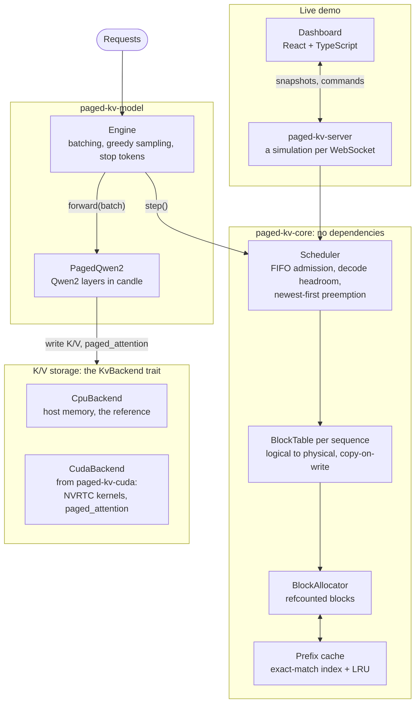
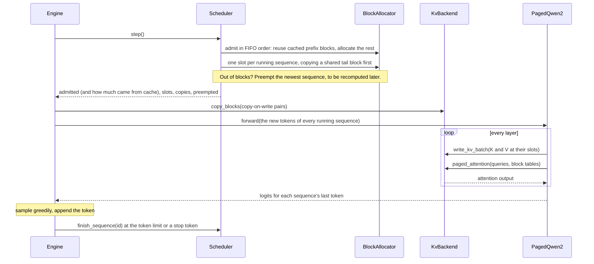

# paged-kv-cache

[](https://github.com/SohamDutta02/paged-kv-cache/actions/workflows/ci.yml)
[](https://colab.research.google.com/github/SohamDutta02/paged-kv-cache/blob/main/notebooks/gpu_check.ipynb)
[](https://colab.research.google.com/github/SohamDutta02/paged-kv-cache/blob/main/notebooks/qwen_check.ipynb)

A vLLM PagedAttention-inspired KV cache memory manager, built from scratch in Rust: block allocator, block table, copy-on-write for beam search, prefix caching, paged attention, a continuous-batching scheduler, and a CUDA backend. It runs a real model, Qwen2.5-0.5B, with every layer's K/V in its blocks, and generates the same tokens as candle's reference implementation and as Hugging Face `transformers` on PyTorch. It is usable from Python (`import paged_kv`) and served over an OpenAI-compatible HTTP API with Prometheus metrics. The workspace has six crates, with a CPU reference backend that serves as a numerical oracle, plus a React and TypeScript dashboard that runs the real scheduler live.

**Live demo:** [paged-kv-cache.onrender.com](https://paged-kv-cache.onrender.com). Each visitor gets their own session: pause and step the scheduler, add requests with or without a shared system prompt, fork sequences, switch prefix caching off to compare, and trace a sequence's block table through the pool. If the instance has been idle, the first load may take a moment.

**Evaluating this project?** The [15-minute guide](docs/evaluating.md) shows what to look at, what to run, and what is and isn't verified. The [API docs](https://sohamdutta.dev/paged-kv-cache/) are rebuilt on every merge.

---

## The problem

Naive KV cache implementations pre-allocate a contiguous buffer sized for each sequence's *maximum* possible length. Most of that buffer sits empty for most of a sequence's life. This was the single biggest source of wasted GPU memory in early LLM serving stacks, and it's why batch sizes stayed small even on large GPUs.

PagedAttention (vLLM, 2023) borrows the fix operating systems have used for virtual memory since the 1960s: don't reserve a contiguous slab up front. Split the cache into small fixed-size physical blocks, and give each sequence a *logical* block table mapping its token positions onto whichever physical blocks it currently owns. A sequence only consumes blocks for tokens it has actually generated. Two sequences that share a prefix (a system prompt, or a beam-search fork) can point at the same physical blocks instead of duplicating them, and only pay for a copy the moment one of them diverges.

```
 seq A block table          physical pool                seq B block table
 (parent)                   (refcounted)                 (forked from A)

 logical 0 ──────────────►  block 7   rc=2  ◄──────────── logical 0
 logical 1 ──────────────►  block 2   rc=2  ◄──────────── logical 1
 logical 2 ──────────────►  block 11  rc=1                logical 2 ─┐
                            block 4   rc=1  ◄────────────────────────┘
                                         ▲
                     B wrote into the shared tail block, so it got a
                     private copy (CoW). Earlier blocks stay shared.
```

This project implements that idea from first principles, in Rust, with a CUDA kernel layer wired in behind a device-agnostic trait.

## Paged vs. contiguous buffers

`cargo run --release -p paged-kv-core --example contiguous_baseline` sends one request stream through four allocators sharing an 8,192-token pool. Three give each sequence a contiguous buffer, placed first-fit so external fragmentation counts; the fourth is the paged scheduler. Prompts are 32–512 tokens. Every request may generate up to 512 tokens, but most stop well short, as real traffic does at end-of-sequence. The batch is capped at 64 and the queue kept 8 deep, for 5,000 steps.

| Allocator | Mean batch | Requests finished | Reserved memory holding tokens | Prompt tokens prefilled per request |
|---|---|---|---|---|
| Contiguous, reserving the model's maximum length (2,048) | 4.0 | 113 | 21% | 281 |
| Contiguous, reserving prompt + max new tokens | 8.5 | 236 | 53% | 273 |
| Contiguous, reserving the exact final length (an oracle) | 12.0 | 317 | 73% | 272 |
| Paged, 16-token blocks | 18.5 | 509 | 98% | 444 |

Paging runs 4.6× the batch of maximum-length reservation, and 1.5× that of an oracle that knows every output length in advance, because a sequence wastes at most part of its last block and free blocks never fragment. Under maximum-length reservation only 21% of reserved memory holds tokens, in line with the 20–38% the vLLM paper measured in earlier serving systems.

The cost is preemption. Paging admits a request without knowing how far it will grow, so when the pool runs out the newest sequence is evicted and its tokens are recomputed later: 293 preemptions here, and 63% more prefill per finished request. The simulator charges every step the same, so that recompute doesn't reduce requests finished; on a GPU it would cost prefill time. Swapping preempted blocks to CPU memory instead of recomputing them is the standard fix, and it is next on the roadmap.

## Architecture



One step of the engine, from scheduling to sampling:



The crates and their main files:

```
crates/
├── paged-kv-core/          device-agnostic memory management (zero dependencies)
│   ├── types.rs            BlockId / SeqId / PhysicalSlot newtypes
│   ├── config.rs           pool geometry, stride math, memory accounting
│   ├── allocator.rs        BlockAllocator: refcounted free-list pool, prefix cache
│   ├── prefix_cache.rs     PrefixIndex: exact-match index of cached prompt blocks
│   ├── lru.rs              O(1) LRU of cached blocks with no owner
│   ├── block_table.rs      BlockTable: logical→physical resolution, CoW fork
│   ├── scheduler.rs        Scheduler: admission, batching, preemption, fork
│   ├── backend.rs          KvBackend trait: the CPU/CUDA seam
│   ├── cpu.rs              CpuBackend: reference implementation, numerical oracle
│   ├── error.rs            CacheError
│   ├── examples/contiguous_baseline.rs   benchmark: paged vs. contiguous buffers
│   └── examples/prefix_caching.rs        benchmark: prefix caching off vs. on
│
├── paged-kv-cuda/          CUDA backend, feature-gated (--features cuda)
│   ├── kernels/kernels.cu  reshape_and_cache, copy_blocks, zero_block, paged_attention
│   └── src/backend.rs      cudarc FFI layer implementing KvBackend
│
├── paged-kv-model/         Qwen2 through the cache, with candle for everything but attention
│   ├── src/model.rs        PagedQwen2: K/V written to blocks, read back by paged_attention
│   ├── src/engine.rs       Engine: Scheduler-driven batching, greedy sampling, stop tokens
│   └── examples/qwen.rs    Qwen2.5-0.5B-Instruct, checked against candle's Qwen2
│
├── paged-kv-serve/         OpenAI-compatible HTTP server with Prometheus metrics
│   ├── src/worker.rs       the engine thread: continuous batching, cancellation
│   ├── src/api.rs          /v1/completions, /v1/chat/completions, streaming
│   └── src/metrics.rs      TTFT, inter-token latency, batch size, cache hits
│
├── paged-kv-py/            Python bindings (PyO3, maturin): import paged_kv
│   ├── src/lib.rs          Engine and Scheduler classes; generation releases the GIL
│   ├── tests/              pytest, including token parity with transformers on PyTorch
│   └── examples/           compare_with_transformers.py for a real checkpoint
│
└── paged-kv-server/        dashboard backend: one simulation per WebSocket session
    ├── src/protocol.rs     wire types; TypeScript generated by ts-rs
    ├── src/sim.rs          Scheduler + traffic generator + session bookkeeping
    └── src/ws.rs           session loop, session cap, idle timeout

web/                        dashboard: React, TypeScript, Vite
├── src/api/generated/      protocol types generated from protocol.rs
├── src/state/              reducer from server messages to session state
├── src/hooks/              WebSocket connection with acks and reconnect
└── src/components/         block pool, sequences, request form, charts, event log
```

`paged-kv-core` has **zero dependencies**, on purpose. Every allocation-policy, copy-on-write, and scheduling decision is pure Rust bookkeeping. None of it needs a GPU, so all of it is testable on a laptop with no NVIDIA hardware and no CUDA toolkit. Device-specific work sits entirely behind the `KvBackend` trait.

## Design decisions worth knowing about

**Copy-on-write is lazy and block-granular, not sequence-granular.** Forking a sequence (`BlockTable::fork`) increfs every block it owns; zero bytes are copied. The copy only happens inside `append`, only for the *tail* block, and only if that block is still shared at the moment of the write. A beam-search fork that diverges late still shares almost its entire prefix in memory, and earlier blocks can stay shared indefinitely.

**Preemption sacrifices the newest arrival, not the current one.** When the scheduler can't get a block, it evicts the *most recently admitted* running sequence. That may be the sequence currently failing to get a block, if it is itself the newest. This matches vLLM's default recompute policy: the newest arrival has the least invested work to lose. A preempted sequence is requeued at the front of the waiting queue with its current context length, and resumes once blocks free up.

**`CpuBackend` is a numerical oracle, not a fallback.** It uses the exact same physical addressing formula as the CUDA kernels:

```
(((layer * num_blocks + block) * block_size + slot) * entry_elems) + i
```

Any behavioral difference between the two backends is a kernel bug, not a design choice. The CUDA backend's tests compare against it on a real GPU.

**Admission is strict FIFO.** If the request at the front of the waiting queue doesn't fit right now, the scheduler doesn't skip ahead to smaller requests behind it, even if those would fit. This prevents large requests from starving indefinitely behind a stream of small ones, at the cost of occasionally idle blocks.

**Admission reserves decode headroom.** A request is admitted only if, after its prompt is placed, enough blocks remain free for every running sequence's next decode token (a new tail block, or a copy-on-write of a shared tail), including its own. Without this, a prompt could take the last free blocks, and the decode in that same step would have to preempt the newest sequence: usually the one just admitted, throwing away its prefill. In a closed-loop simulation under memory pressure, the headroom cut prompt tokens prefilled by 31–63% (depending on pool and batch size), and admit-then-preempt in the same step went to zero, with no change in completed requests.

## Prefix caching

Real traffic repeats itself at the start of the prompt: the same system prompt, the same few-shot examples, the same document under different questions. With prefix caching on (`Scheduler::with_prefix_caching`), every full prompt block is registered in a cache as it is written, and a later request whose prompt starts with the same tokens takes those blocks by reference instead of computing them again. A cache hit is an incref, the same refcounting that copy-on-write already relies on, so cached blocks are shared rather than copied.

**Keys are exact, not hashes.** A block is keyed by its tokens together with the cache entry of the block before it, so it only matches when the entire prefix up to and including it matches. The key holds the tokens themselves, so a hash collision costs a comparison, never a wrong hit. Entry ids are never reused: once a block is evicted, nothing keyed under its old entry can match whatever is written into it next.

**Cached blocks outlive their sequences, until memory is needed.** When the last sequence using a cached block releases it, the block goes onto an LRU list instead of the free list. It still counts as free: allocation takes from the free list first and evicts the least recently released cached block only when the free list is empty. Sequences release blocks tail first, so eviction takes the end of a prefix before its start, and the shared start, which the most requests can reuse, lasts longest.

**The last prompt token is always computed.** Even when the whole prompt is cached, the model has to run on its final token to produce the first output token, so matching stops one token short, as in vLLM.

**Admission counts what a hit costs.** Reusing a cached block that no one owns takes it out of the reclaimable pool, so it counts against the request's block budget like a fresh allocation, on top of the decode headroom above.

### Measured

`cargo run --release -p paged-kv-core --example prefix_caching` runs three closed-loop workloads, each twice on the identical request stream: 512 blocks of 16 tokens, a batch of up to 32, a queue kept 8 deep, 5,000 steps.

| Workload | Prompt tokens computed | Mean batch | Requests finished | Preemptions |
|---|---|---|---|---|
| Chat: 90% of requests start with one of 4 system prompts (220–450 tokens) | 300,537 → 92,555 (−69%) | 16.8 → 31.8 | 569 → 1,097 | 215 → 4 |
| Few-shot: every request starts with the same 1,000 tokens | 8,062,968 → 1,660,933 (−79%) | 5.5 → 24.2 | 7,746 → 34,536 | 0 → 0 |
| No shared prefixes | 299,987 → 247,651 (−17%) | 17.7 → 17.7 | 599 → 599 | 221 → 221 |

Because hits share blocks instead of duplicating them, the same pool holds more sequences: the mean batch nearly doubles for chat and more than quadruples for few-shot. With nothing to share, the whole saving comes from preempted requests finding their own prompt blocks still cached when they are readmitted. The simulator charges every step the same, so "requests finished" measures the capacity gain alone; on a GPU the skipped prefill would also cut time to first token.

## A real model

`paged-kv-model` runs Qwen2 with its K/V in the block cache. `PagedQwen2` mirrors candle's Qwen2 layer for layer, using the same RMSNorm, linear, embedding and RoPE ops, with one difference: each layer writes its K/V into the slots the scheduler assigned and reads them back with `paged_attention`. `Engine` drives it with the real `Scheduler`, so batching, prefix-cache hits and preemption with recompute all happen as they do in the simulations. After every step, a running sequence's block table holds one more slot than it has K/V for: the slot of the token just sampled, which is filled when that token is fed back in on the next step.

[`notebooks/qwen_check.ipynb`](notebooks/qwen_check.ipynb) runs Qwen2.5-0.5B-Instruct on four chat prompts that share a system prompt, then runs the same prompts through candle's own Qwen2 and compares every generated token. On a Colab T4 runtime:

| K/V cache | Answers identical to candle's Qwen2 | Prompt tokens from the prefix cache | Time for 221 tokens |
|---|---|---|---|
| Host memory (`CpuBackend`) | 4 of 4 | 96 of 171 | 26.4 s |
| On the T4 (`CudaBackend`, attention in the CUDA kernel) | 4 of 4 | 96 of 171 | 27.1 s |

> **Q:** What is a hash table?
>
> **A:** A hash table is a data structure that uses a hash function to store and retrieve data. It works by mapping keys to indices in an array, which allows for quick lookups and insertions. This is particularly useful for storing large amounts of data in a compact form.

Everything except attention runs on the CPU in both rows, so the times reflect batching, not the GPU: candle's reference took 44 s for the same tokens, one prompt at a time. Running the whole model on the GPU is on the roadmap.

CI checks the same equivalence without downloading anything. Tests load identical random weights into `PagedQwen2` and candle's Qwen2: logits agree to 1e-4 across mixed prefill and decode batches, and the engine generates the reference's exact tokens through prefix-cache hits and a preemption. The weights are scaled so that wrong K/V changes what gets generated, and writing K/V one slot off fails all three equivalence tests.

## Python

`crates/paged-kv-py` builds a `paged_kv` Python package with PyO3 and maturin:

```python
import paged_kv

engine = paged_kv.Engine("Qwen2.5-0.5B-Instruct", stop_tokens=[151645, 151643])
answers = engine.generate(prompts, max_new_tokens=64)   # prompts: lists of token ids
print(engine.stats)   # prefill tokens computed and cached, preemptions, steps
```

`Engine` loads any Qwen2 checkpoint directory (`config.json` plus `.safetensors`) and runs a whole batch through the paged cache, releasing the GIL while it works; `device="cuda"` keeps the K/V cache on the GPU in builds with the `cuda` feature. `Scheduler` exposes the scheduler on its own, for trying batching and memory policies without a model. Type stubs ship with the package, and its [README](crates/paged-kv-py/README.md) has a full example with a tokenizer.

CI checks it against Hugging Face `transformers` on PyTorch. A test builds a tiny Qwen2 with `transformers`, saves it, and requires `paged_kv` to generate exactly the tokens of plain greedy decoding in PyTorch, through prefix-cache hits and a preemption. On a real checkpoint, the last cell of the [Qwen notebook](notebooks/qwen_check.ipynb) runs the same comparison with Qwen2.5-0.5B-Instruct.

## Serving

`paged-kv-serve` serves a Qwen2 checkpoint over an OpenAI-compatible HTTP API, so existing clients work unchanged:

```bash
cargo run --release -p paged-kv-serve -- --model Qwen2.5-0.5B-Instruct --port 8000
```

```python
from openai import OpenAI

client = OpenAI(base_url="http://localhost:8000/v1", api_key="unused")
stream = client.chat.completions.create(
    model="Qwen2.5-0.5B-Instruct",
    messages=[{"role": "user", "content": "What is a hash table?"}],
    stream=True,
)
for chunk in stream:
    print(chunk.choices[0].delta.content or "", end="")
```

| Endpoint | What it does |
|---|---|
| `POST /v1/completions` | Text or token-id prompts. `stream: true` sends server-sent events in OpenAI's chunk format. |
| `POST /v1/chat/completions` | Renders the model's own Jinja chat template, as `transformers` does, then generates. Streams the same way. |
| `GET /v1/models`, `GET /health` | For clients and load balancers. |
| `GET /metrics` | Prometheus histograms for time to first token, inter-token latency, request duration, step duration and batch size; counters for prefix-cache hits, preemptions and request outcomes; gauges for running and waiting requests and KV cache use. |

One thread owns the engine and runs a step whenever any request is live. A request that arrives mid-step joins the next one, which is continuous batching. When a client disconnects, its request is cancelled and its blocks are freed at once, queued or running. Past `--max-in-flight` the server answers 429.

Only greedy decoding is implemented. A request that asks for anything else, such as a nonzero temperature, `top_p`, `n` above 1, or stop strings, gets a clear 400 rather than being silently ignored. As in the Qwen check, the model's matrix multiplications run on the CPU; with `--features cuda` and `--device cuda` the K/V cache and attention move to the GPU. `--dummy-weights` runs a checkpoint's architecture with random weights, which is enough to benchmark latency without downloading the weights.

Nine integration tests drive the API in process and compare every answer with the engine run directly. They cover streaming, chat, concurrent requests sharing batches, cancellation on disconnect, the in-flight limit and rejected settings. The official OpenAI Python SDK (3.31) works against the server unchanged, checked by hand.

## Benchmarks

[docs/benchmarks.md](docs/benchmarks.md) load tests the server on a 2-CPU machine, with Qwen2.5-0.5B's architecture and random weights:

- **Continuous batching:** throughput rises 4.3× from 1 concurrent client to 16 (3.1 to 13.3 output tokens/s). Each step reads the weights once for the whole batch.
- **Prefix caching:** with a shared 256-token system prompt, median time to first token falls 5.7× (39.2 s to 6.8 s) and throughput nearly triples, as 85% of prompt tokens come from the cache.

`bench/run_benchmark.sh` reproduces the whole report. CI runs a quick version on every pull request and fails if requests fail, batching stops, or prefix caching stops halving prompt computation.

## Status

| Component | Status |
|---|---|
| `paged-kv-core` (allocator, block table, scheduler, prefix cache) | **74 tests passing.** Includes randomized tests (allocator churn, block-table fork/append/free, and scheduler arrivals/forks/preemption, with prefix caching off and on) that check after every operation that each block's refcount equals the number of block tables referencing it. A randomized cache test checks every hit against a model of what each block holds, so a wrong match fails immediately. Paged attention is checked against plain dense attention on scattered block tables. Plus hand-traced preemption, CoW and cache-reuse scenarios. |
| `paged-kv-cuda` (kernels + FFI) | **6 tests passing on a Tesla T4.** The cache kernels match `CpuBackend` element for element, including a randomized test that runs 300 batched writes, block copies and zeroings and compares both entire pools. The attention kernel matches the CPU reference to rounding on contexts up to 500 tokens. [`notebooks/gpu_check.ipynb`](notebooks/gpu_check.ipynb) reruns them on a free Colab or Kaggle T4. CI has no GPU, so it type-checks the FFI layer with `--features cuda` and compiles `kernels.cu` with NVRTC, checking that every kernel the backend loads is exported. |
| `paged-kv-server` (dashboard backend) | **20 tests passing.** Unit tests on the simulation and wire format, including a 2,000-tick randomized run that checks scheduler invariants every tick, plus integration tests over a real WebSocket for the protocol, session isolation, the session cap and static serving. |
| `web/` (dashboard) | **39 tests passing.** Reducer, connection hook (against a fake WebSocket) and component tests. Type-checked in strict mode and linted with type-aware rules in CI. |
| `paged-kv-model` (Qwen2 through the cache) | **4 tests passing, and verified with Qwen2.5-0.5B on a Colab T4.** Token-identical to candle's Qwen2 with the cache in host memory and on the GPU; see [A real model](#a-real-model). |
| `paged-kv-py` (Python bindings) | **6 tests passing**, run in CI with PyTorch installed. The engine generates the same tokens as `transformers` on a tiny Qwen2, including prefix-cache hits, preemption and stop tokens; see [Python](#python). |
| `paged-kv-serve` (HTTP server) | **9 tests passing.** OpenAI-compatible completions and chat with streaming, checked against the engine run directly, plus cancellation, batching and limits; see [Serving](#serving). |
| `paged_attention` (attention over the cache) | **Implemented on CPU and CUDA, verified on a Tesla T4.** One call covers decode and prefill, including prefill after a prefix-cache hit: each sequence's last `num_queries` tokens attend causally to its whole context through the block table, with grouped-query heads. The CUDA kernel favours clarity over speed (one thread block per query and head, scores in a scratch buffer); a tiled kernel with online softmax is future work. |

## Running it

```bash
# all Rust tests: fast, no GPU needed
cargo test --workspace

# benchmarks
cargo run --release -p paged-kv-core --example contiguous_baseline
cargo run --release -p paged-kv-core --example prefix_caching

# Qwen2.5-0.5B-Instruct through the cache; the directory holds config.json,
# tokenizer.json and model.safetensors. Add --features cuda to keep K/V on the GPU.
cargo run --release -p paged-kv-model --example qwen -- <model-dir>

# load test the server and write charts and tables (QUICK=1: a tiny model, seconds)
bench/run_benchmark.sh

# OpenAI-compatible server; --dummy-weights needs only config.json and tokenizer.json
cargo run --release -p paged-kv-serve -- --model <model-dir> --port 8000

# Python bindings, tested against transformers on PyTorch
pip install ./crates/paged-kv-py torch transformers pytest
pytest crates/paged-kv-py/tests

# the dashboard, locally
(cd web && npm ci && npm run build)
cargo run --bin paged-kv-server          # → http://localhost:8080

# frontend work with hot reload; proxies /api to the server above
cd web && npm run dev                    # → http://localhost:5173

# containerized
docker build -t paged-kv-demo .
docker run -p 8080:8080 paged-kv-demo

# CUDA backend: requires an NVIDIA GPU + driver
cargo test -p paged-kv-cuda --features cuda
# no GPU? open notebooks/gpu_check.ipynb in Colab with a T4 runtime
```

The server binds to `$PORT` if set (as on Render), otherwise 8080. `STATIC_DIR` overrides where the built dashboard is served from; the Docker image sets it. `GET /api/health` returns `ok`.

### How the dashboard works

Each WebSocket connection to `/api/ws` gets its own simulation: the real `Scheduler` over a 64-block pool (8 tokens per block, batch of 6, queue of 24), stepping every 400 ms. A traffic generator adds a request every 3 ticks, three in four of them starting with one of three shared system prompts (40, 56 and 24 tokens), and forks a running sequence every 5. You can turn it off and drive the scheduler yourself. Prefix caching is on by default; in the block pool, a dashed outline marks a cached block with no owner, free to be evicted but still reusable, and a dot marks a prompt block in the cache.

The server pushes a snapshot every tick. The browser sends commands (`add_request`, `fork`, `pause`, `resume`, `step`, `reset`, `set_traffic`, `set_prefix_caching`), each with an id that the server echoes in its acknowledgement, along with a reason when it rejects one. The message types live in `crates/paged-kv-server/src/protocol.rs`; `cargo test` regenerates their TypeScript in `web/src/api/generated/`, and CI fails if the committed copies are stale.

Sessions are capped at 100; past that, new connections are closed with code 1013 and asked to retry. A session also closes after 30 minutes without input.

## Roadmap

- Swap preempted blocks to CPU memory instead of recomputing them
- A faster attention kernel: tiled, online softmax, half precision
- Run the whole model on the GPU, then measure throughput against a contiguous cache

## License

MIT
