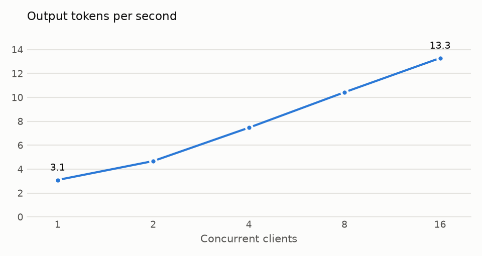
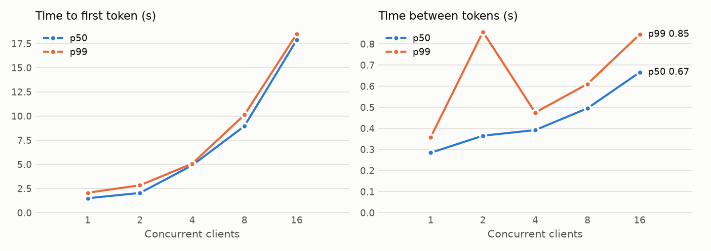
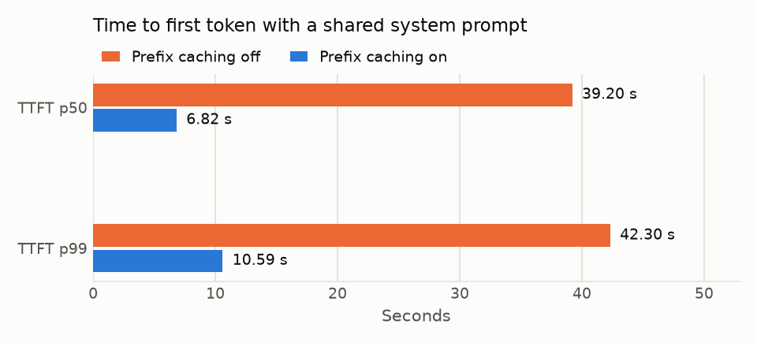

# Benchmarks

Load tests of `paged-kv-serve`, the OpenAI-compatible server, on a 2-CPU machine. They answer two questions: how much does continuous batching raise throughput, and how much does prefix caching cut time to first token when requests share a system prompt?

Everything here is reproducible with one command (see [Reproduce](#reproduce)), and the raw results are in [`benchmarks/`](benchmarks/).

## Setup

| | |
|---|---|
| Machine | Cloud container: 2 vCPUs (Intel Xeon, 2.8 GHz), 8 GB RAM, no GPU |
| Model | Qwen2.5-0.5B-Instruct's architecture: 24 layers, hidden size 896, 14 query heads over 2 KV heads, 151,936-token vocabulary. Random weights in f32 (`--dummy-weights`) |
| KV cache | 1,024 blocks of 16 tokens: 16,384 tokens, 384 MiB at 24 KiB per token |
| Server | `paged-kv-serve --num-blocks 1024 --block-size 16 --max-batch-size 16`, prefix caching on unless stated |
| Client | [`bench/load_test.py`](../bench/load_test.py), closed loop: each of C clients sends streaming requests back to back |

**Why random weights:** this workspace can't download the checkpoint. Random weights have the real model's shapes, so every step does the same work and the timings carry over; only the generated text is meaningless. The config also has no end-of-sequence token, so every request generates exactly the tokens it asks for.

**Measurements:**
- **Time to first token (TTFT):** from sending a request to receiving its first streamed token.
- **Time between tokens:** the gaps between consecutive streamed tokens.
- **Throughput:** all output tokens divided by the level's wall-clock time.
- **Mean batch:** taken from the server's own `/metrics`.

Each level starts with a warm-up request, and each configuration ran once.

## Continuous batching

Prompts of 32–128 random tokens, 32 output tokens each, four requests per client (at least 8).

<picture>
  <source media="(prefers-color-scheme: dark)" srcset="benchmarks/throughput-dark.png">
  
</picture>

<picture>
  <source media="(prefers-color-scheme: dark)" srcset="benchmarks/latency-dark.png">
  
</picture>

| Clients | Requests | Tokens/s | Requests/s | TTFT p50 | TTFT p99 | Between tokens p50 | p99 | Latency p99 | Mean batch | Errors |
|---|---|---|---|---|---|---|---|---|---|---|
| 1 | 8 | 3.1 | 0.10 | 1.49 s | 2.06 s | 0.28 s | 0.36 s | 11.0 s | 1.0 | 0 |
| 2 | 8 | 4.7 | 0.15 | 2.04 s | 2.84 s | 0.37 s | 0.86 s | 14.4 s | 1.9 | 0 |
| 4 | 16 | 7.5 | 0.23 | 4.90 s | 5.06 s | 0.39 s | 0.47 s | 17.9 s | 3.9 | 0 |
| 8 | 32 | 10.4 | 0.33 | 8.96 s | 10.12 s | 0.49 s | 0.61 s | 25.6 s | 7.8 | 0 |
| 16 | 64 | 13.3 | 0.42 | 17.85 s | 18.48 s | 0.67 s | 0.85 s | 39.3 s | 15.5 | 0 |

**Throughput rises 4.3× from 1 client to 16.** A decode step reads every weight once whatever the batch size, so on a CPU, where decoding is limited by memory bandwidth, adding sequences to a step costs far less than running them one after another. The server's mean batch tracks the client count (15.5 at 16 clients), so requests are joining batches as intended.

**The cost is latency.**
- **Time between tokens** more than doubles (0.28 s to 0.67 s at p50), because each step carries more sequences.
- **Time to first token** grows almost linearly with clients. In a closed loop with equal output lengths, clients start and finish in waves, so up to 16 prompts arrive together and are prefilled in a single step that every one of them waits for.
- **The p99 spike at 2 clients** has the same cause in a smaller form: a new request's prefill runs in the same step as the other request's decode, and stalls it.

Chunked prefill, which splits large prefills across steps, would flatten both. It's on the roadmap.

## Prefix caching

Eight clients, 24 requests. Every prompt is the same 256-token system prompt followed by a 16–48-token user part, with 16 output tokens each. The server was restarted between the two runs.

<picture>
  <source media="(prefers-color-scheme: dark)" srcset="benchmarks/prefix-ttft-dark.png">
  
</picture>

| Prefix caching | TTFT p50 | TTFT p99 | Latency p50 | Prompt tokens computed | From cache | Tokens/s | Errors |
|---|---|---|---|---|---|---|---|
| Off | 39.20 s | 42.30 s | 47.8 s | 6933 | 0 | 2.6 | 0 |
| On | 6.82 s | 10.59 s | 15.4 s | 1045 | 5888 | 7.6 | 0 |

**Prefix caching cuts median time to first token 5.7×, from 39.2 s to 6.8 s, and nearly triples throughput.**
- After the first request computes the system prompt, later requests take its 16 full blocks from the cache and compute only their own part.
- 85% of prompt tokens come from the cache.
- On a CPU, prefill is the expensive phase, so skipping it shows up directly in both latency and throughput.

## Memory

The server's resident memory went from 1,971 MiB with one client to 2,303 MiB with 16.
- **Weights:** 1,884 MiB of that (494 million parameters in f32). bfloat16 weights would halve it.
- **K/V:** the cache is allocated up front but only touched as used. At 16 clients it peaked at 12.6% of the pool, about 48 MiB.
- **The rest of the growth:** working buffers for larger batches.

How much more a paged cache fits in the same memory than per-request buffers is measured separately, by [`examples/contiguous_baseline.rs`](../crates/paged-kv-core/examples/contiguous_baseline.rs): 4.6× the batch of max-length reservation. See [Paged vs. contiguous buffers](../README.md#paged-vs-contiguous-buffers).

## Limits

- **CPU only.** The model's matrix multiplications run on the CPU, so these numbers show how batching and caching scale, not absolute GPU speed. Running the whole model on the GPU is on the roadmap.
- **f32 weights.** Real deployments use bfloat16 or quantized weights, which roughly halve memory traffic.
- **Simple load pattern.** It is a closed loop with fixed output lengths, not Poisson arrivals with varied lengths, which is why clients move in waves.
- **One run per configuration, on a shared VM.** Expect a few percent of run-to-run noise. The effects above are far larger than that.

## Reproduce

```bash
pip install -r bench/requirements.txt
bench/run_benchmark.sh                          # this report: about 15 minutes on 2 CPUs
MODEL=path/to/Qwen2.5-0.5B-Instruct bench/run_benchmark.sh   # real weights
QUICK=1 bench/run_benchmark.sh                  # tiny model, seconds
```

Results, charts and `summary.md` go to `bench/results/` (or `$OUT`).

CI runs the quick version on every pull request and uploads the results. It fails the build if any request fails, if concurrent requests stop being batched together, or if prefix caching stops at least halving prompt computation. Those are properties of the scheduler that hold on any machine. Timings vary too much between CI runners to gate on.
